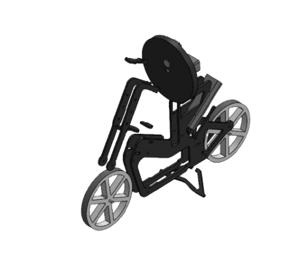
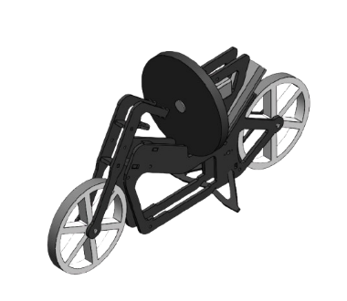
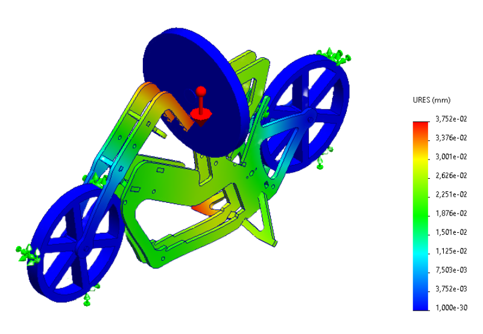
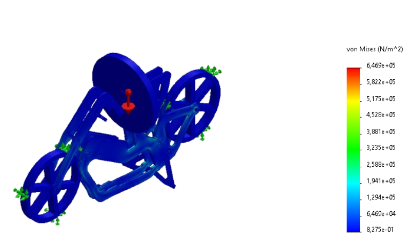
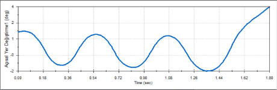
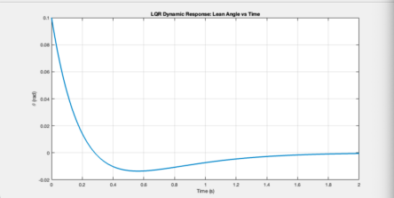
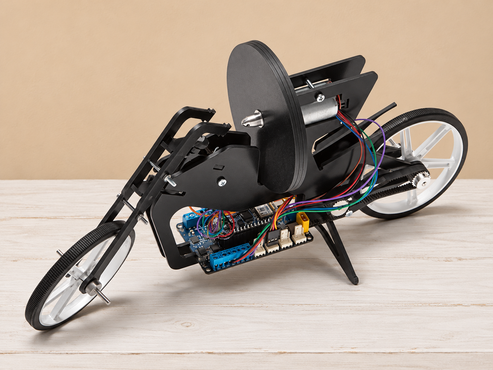

# Self-Balancing Motorcycle

Mechanical design and balance analysis showcase · Academic Project · 2025

[Türkçe açıklama](README.tr.md)

## Project Overview

A motorcycle project exploring balance through a single reaction wheel. My main responsibility was mechanical design and analysis, with a supporting contribution to the control-system work.

A physical prototype was assembled as part of the project. The material currently presented here documents the CAD design and simulations; the linked video is a SolidWorks dynamic-analysis recording.

## Mechanical Design

*Digital assembly showing the chassis, motorcycle wheels, and reaction-wheel mechanism.*

*Alternative view of the mechanical assembly.*

## My Contribution

- Created the motorcycle's mechanical design in SolidWorks.
- Performed mechanical analyses, including the selected displacement and stress studies shown below.
- Used SolidWorks dynamic analysis to examine balance behaviour in relation to wheel acceleration.
- Supported the Arduino-based control-system work.

## Selected Structural Analyses

### Resultant Displacement

*Resultant displacement (URES), in millimetres, for the load and restraint setup illustrated.*

### von Mises Stress

*von Mises stress distribution, in N/m², for the load and restraint setup illustrated.*

## SolidWorks Dynamic Analysis

[Watch the dynamic-analysis recording](videos/solidworks-dynamic-analysis.mp4)

The recording shows the digital motorcycle model and reaction-wheel mechanism in a SolidWorks dynamic-analysis scene.

*Angular displacement versus time from the SolidWorks dynamic analysis. This plot shows the model response during the illustrated simulation interval.*

## Control Simulation

My contribution to the control-system work was in a supporting role. The following LQR response is included as project context; my primary responsibility was mechanical design and analysis.

*Lean-angle response from the project's LQR simulation. This is a separate simulation result from the SolidWorks motion-analysis plot above.*

## Tools and Platform

SolidWorks · MATLAB · Simulink · Arduino

## Reference Visualization

As part of the project, we also built and assembled a physical prototype. The image below is included to illustrate the mechanism.

*Reference image with an AI-edited background. This is an illustrative reference, not a photograph documenting this project's physical prototype.*

## Portfolio Scope

This repository contains selected visuals, a simulation recording, and summary documentation. Original CAD models, simulation source files, code, and the full project report remain outside this public showcase.
