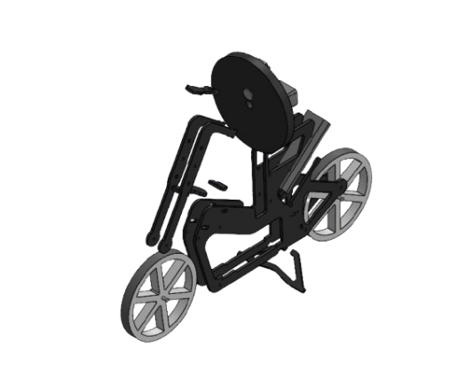
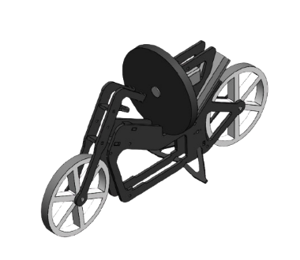
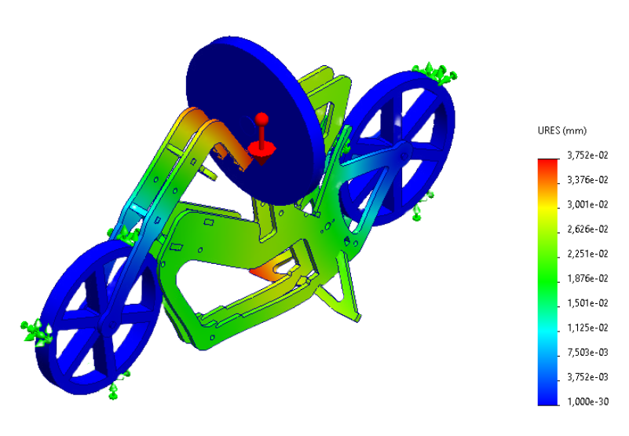
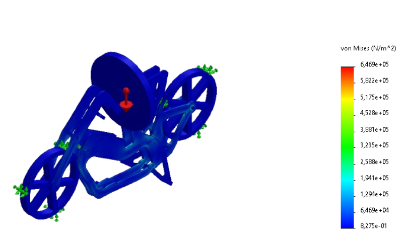
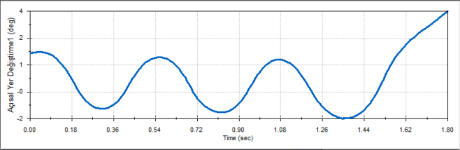
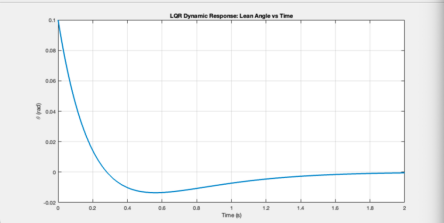
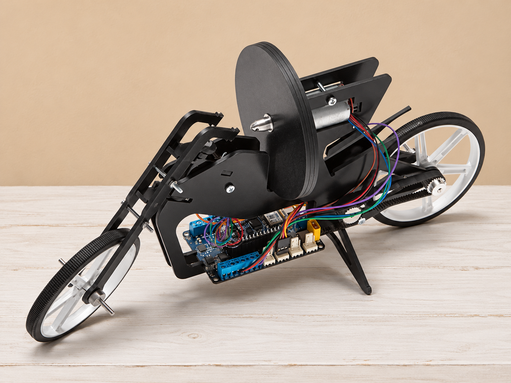

# Kendini Dengeleyen Motosiklet

Mekanik tasarım ve denge analizi portföyü · Akademik Proje · 2025

[English version](README.eng.md)

## Proje Özeti

Tek tepki çarkı kullanılarak motosikletin dengelenmesini ele alan proje. Ana sorumluluğum mekanik tasarım ve analiz olup kontrol sistemi çalışmalarına destek verdim.

Proje kapsamında fiziksel prototipin montajı yapılmıştır. Bu sayfada şu anda CAD tasarımı ve simülasyon çalışmaları sunulmaktadır; bağlantısı verilen video bir SolidWorks dinamik analiz kaydıdır.

## Mekanik Tasarım

*Şasiyi, motosiklet tekerleklerini ve tepki çarkı mekanizmasını gösteren dijital montaj.*

*Mekanik montajın farklı açıdan görünüşü.*

## Projedeki Katkım

- Motosikletin mekanik tasarımını SolidWorks ile gerçekleştirdim.
- Aşağıda seçilmiş örnekleri bulunan yer değiştirme ve gerilme çalışmaları dâhil mekanik analizleri yürüttüm.
- Tekerleğin ivmesine bağlı denge davranışını SolidWorks dinamik analiziyle inceledim.
- Arduino tabanlı kontrol sistemi çalışmalarına destek verdim.

## Seçilmiş Yapısal Analizler

### Bileşke Yer Değiştirme

*Gösterilen yük ve mesnet düzeni için milimetre cinsinden bileşke yer değiştirme (URES).*

### von Mises Gerilmesi

*Gösterilen yük ve mesnet düzeni için N/m² cinsinden von Mises gerilme dağılımı.*

## SolidWorks Dinamik Analizi

[Dinamik analiz kaydını izle](videos/solidworks-dynamic-analysis.mp4)

Kayıt, dijital motosiklet modelini ve tepki çarkı mekanizmasını SolidWorks dinamik analiz sahnesinde göstermektedir.

*SolidWorks dinamik analizinden zamana bağlı açısal yer değiştirme grafiği. Gösterilen simülasyon aralığındaki model tepkisini ifade eder.*

## Kontrol Simülasyonu

Kontrol sistemi çalışmalarına destekleyici rolde katkıda bulundum. Aşağıdaki LQR tepkisi projeyi açıklamak amacıyla sunulmaktadır; ana sorumluluğum mekanik tasarım ve analizdir.

*Projenin LQR simülasyonundan yatış açısı tepkisi. Yukarıdaki SolidWorks hareket analizi grafiğinden ayrı bir simülasyon sonucudur.*

## Kullanılan Araçlar ve Platform

SolidWorks · MATLAB · Simulink · Arduino

## Referans Görselleştirme

Proje kapsamında fiziksel bir prototip de üreterek montajını gerçekleştirdik. Aşağıdaki görsel, mekanizmayı açıklamak amacıyla eklenmiştir.

*Arka planı yapay zekâyla düzenlenmiş referans görsel. Bu görsel, projeye ait fiziksel prototipi belgeleyen bir fotoğraf olarak sunulmamaktadır; temsili olarak eklenmiştir.*

## Portföy Kapsamı

Bu depoda seçilmiş görseller, simülasyon kaydı ve özet açıklamalar bulunur. Orijinal CAD modelleri, simülasyon kaynak dosyaları, kodlar ve tam proje raporu bu açık tanıtım alanına dâhil değildir.
